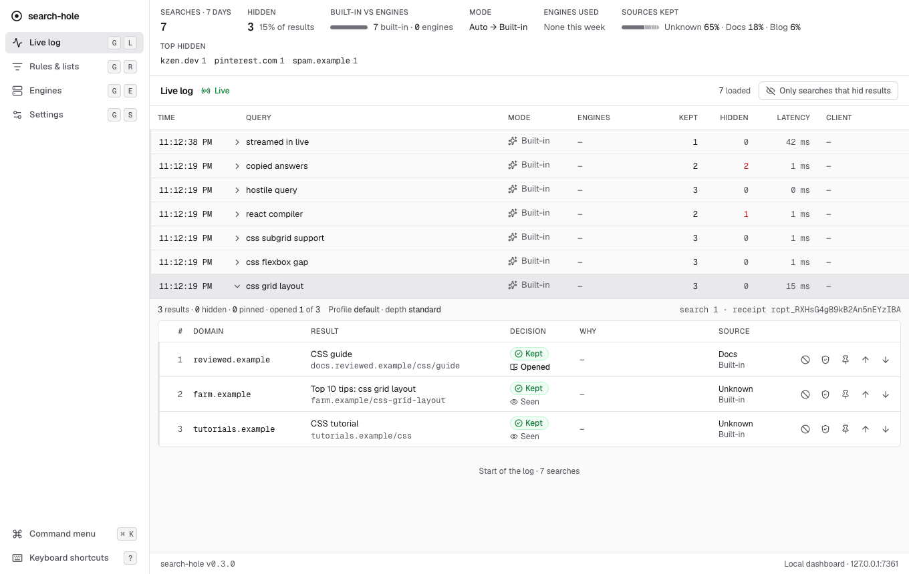
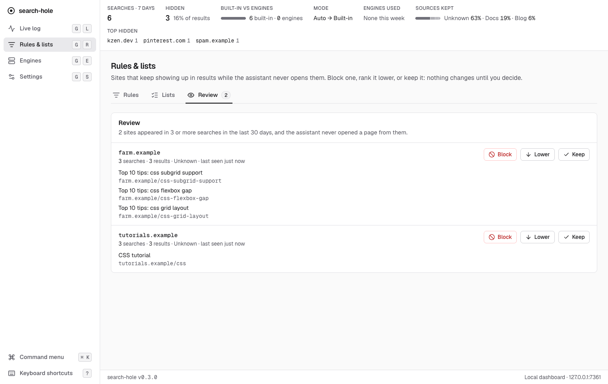

# search-hole

A local search gateway for AI assistants. It records every web search your assistant runs and which pages it opened, lets you block, pin, raise or lower sites, and gives each answer a receipt of what was searched, hidden and opened. Everything is stored on your machine.



**Status: 0.3.0, a pre-release.** It is not on npm or in a plugin marketplace yet, so you install it from this repository (about five minutes, below). How it works: [ARCHITECTURE.md](ARCHITECTURE.md). Why it is built this way: [docs/adr/](docs/adr/README.md).

What has real use behind it, and what does not:

| Where | State |
|---|---|
| Claude Code on macOS | Used daily |
| Claude Code on Linux and Windows | Passes the test suite in CI on both; not yet used daily |
| Claude Desktop, VS Code, Cursor, Codex, Windsurf, Zed, Goose | Built, and each config is checked by tests; **not yet tried in the real app** |

## Requirements

- Claude Code 2.1.296 or newer (tested on 2.1.312).
- Node.js 22.19 or newer on your PATH. Without it the plugin shows a message at session start and the MCP server cannot run.
- To build: [mise](https://mise.jdx.dev), which installs the pinned Node and pnpm for this repository.
- Optional, for better results: Docker (a private SearXNG engine) or a free Tavily key. See [Optional engines](#optional-engines).

## Install in Claude Code

1. Clone the repository, then install the toolchain and the dependencies, and build the plugin:

   ```sh
   mise install
   mise exec -- pnpm install --frozen-lockfile
   mise exec -- node scripts/build-plugin.mjs
   ```

   The last command builds the package and assembles `distribution/marketplace/search-hole/`, then prints the next step with your paths.

2. Install it from the local marketplace `search-hole-local`. In a terminal:

   ```sh
   claude plugin marketplace add "<repo>/distribution/marketplace"
   claude plugin install search-hole@search-hole-local
   ```

   Or inside Claude Code: `/plugin marketplace add "<repo>/distribution/marketplace"`, then `/plugin install search-hole@search-hole-local`.

   For a quick try with nothing installed: `claude --plugin-dir "<repo>/distribution/marketplace/search-hole"`.

3. Restart Claude Code, then run `/search-hole:doctor`. The plugin has two optional settings, a Brave key and a Tavily key. Leave them empty to start with no setup; change them later with `claude plugin configure search-hole`.

4. Ask a question that needs the web. If the turn searched, a one-line receipt appears when it ends, for example:

   ```text
   search-hole · 2 searches (2 built-in) · 18 results · 3 hidden · receipt rcpt_…
   ```

After a rebuild, run the build script again and restart Claude Code.

## What you get with no setup

With no engine and no key, Claude Code keeps using its own web search, and search-hole works around it:

- **A log of every search:** the query, each result, and whether a rule hid it. `/search-hole:log`, or the dashboard.
- **Your rules applied to Claude's search:** blocked sites are left out of the search and removed from its results; pins and raises reorder what is left.
- **A receipt per turn.**
- **Opened or seen:** each result in the log is marked with whether Claude opened that page or was only shown it.
- **A review list:** sites that keep coming back in results and are never opened, each with Block, Lower and Keep. `/search-hole:review`, or the Review tab in the dashboard.
- **Lists:** shared block lists that work under your own rules (see [Lists](#lists)).

Adding an engine gives snippets, dates, freshness rules and better ranking; see [Optional engines](#optional-engines).

## Claude Desktop

Not yet tried in the real app.

1. Build the extension (after the three commands above):

   ```sh
   mise exec -- pnpm -C packages/search-hole build:mcpb
   ```

   It writes `distribution/out/search-hole-<version>.mcpb`.
2. In Claude Desktop, open Settings → Extensions → Install Extension…, and pick that file. Leave the Brave and Tavily keys empty, or paste a key; Desktop keeps it in your system keychain.
3. Ask Claude to search, then to show the search-hole receipt. Desktop shows it as a card. "Full receipt" lists what was searched and opened, with a Block button beside each site; "Block a site…" (shown when a page was opened) takes you there. Claude can't press these buttons; only you can.

Desktop has no way to filter its own search, so search-hole is the search tool there and **needs an engine**: a Tavily key in the extension's settings, or `searchhole searxng up` in a terminal.

## Search modes

The default is `auto`. Change it with `/search-hole:mode auto|builtin|engines` (or `searchhole mode …`); a running session picks the change up on its next search. The `SEARCHHOLE_MODE` environment variable overrides the setting.

| Mode | What happens |
|---|---|
| `auto` (default) | With a healthy engine, WebSearch is steered to search-hole's `search` (full ranking, snippets, dates). With none, Claude's own WebSearch runs, filtered by your rules. It upgrades by itself when you add an engine. |
| `builtin` | Claude's own WebSearch always runs. Your blocked domains are added to the search, and results are filtered again afterwards. |
| `engines` | Searches always go to search-hole's engines. The built-in search runs (filtered) only if every engine fails. |

## Slash commands

All of these are user-only: Claude cannot run them. A `<match>` is a domain (`example.com`), a host and path (`example.com/blog`), a URL pattern with `*`, or a `/regex/`. Arguments are passed to a shell, so quote anything that contains `*`, `|` or spaces.

| Command | What it does |
|---|---|
| `/search-hole:block <match>` | Hide a site from results |
| `/search-hole:allow <match>` | Always show a site, even if a list blocks it |
| `/search-hole:pin <match>` | Put a site's results first |
| `/search-hole:raise <match>` / `lower <match>` | Move a site up or down (`--weight 1-10`) |
| `/search-hole:unblock <id-or-match>` | Remove a rule you added (also undoes raise and lower) |
| `/search-hole:rules` | List your rules |
| `/search-hole:log [show <id>]` | Recent searches and what was hidden |
| `/search-hole:explain <site-or-url>` | Why a URL is shown or hidden |
| `/search-hole:review [keep <site>]` | Sites seen in 3 or more searches and never opened; `keep` takes one off the list |
| `/search-hole:suggestions` | Rules Claude suggested, waiting for you |
| `/search-hole:approve <id>` / `reject <id>` | Decide on a suggestion |
| `/search-hole:mode [auto\|builtin\|engines]` | Show or set the mode |
| `/search-hole:doctor` | Check Node, hooks, engines and keys |
| `/search-hole:status` | Quick health check (`doctor --probe`) |
| `/search-hole:dashboard` | Open the dashboard in your browser |
| `/search-hole:lists [catalog\|add\|update\|enforce\|audit\|disable…]` | See and manage block lists and their effect |
| `/search-hole:searxng up --yes` / `status` / `down` | Manage the private SearXNG engine (`--yes` allows the first download, since there is no terminal to ask) |

The plugin also ships a `research` skill that Claude loads when it searches: when to use `search` or `fetch`, how deep to go, citing with dates, and saying "opened" rather than "cited". Claude can only suggest rules (`suggest_rule`); you approve them.

## CLI basics

The same build is a command line tool (`searchhole`, or `node <repo>/packages/search-hole/dist/searchhole.mjs` from a checkout):

```sh
searchhole doctor                 # check the setup and get fixes
searchhole log                    # recent searches, with how many results were opened
searchhole review                 # sites that keep showing up and are never opened
searchhole block pinterest.com    # hide a site (undo: searchhole unblock pinterest.com)
searchhole explain pinterest.com  # why a site is shown or hidden
```

`searchhole search "<query>" --explain` runs a search and shows every decision. It uses search-hole's own engines, so it needs one set up first ([Optional engines](#optional-engines)).

Your data lives in one place, which `searchhole doctor` prints: `~/.searchhole/` on macOS; `~/.config/searchhole/` and `~/.local/share/searchhole/` on Linux; `%APPDATA%\searchhole\` and `%LOCALAPPDATA%\searchhole\` on Windows. `SEARCHHOLE_HOME` overrides it. It holds a SQLite log plus your `rules.yaml` and `settings.yaml`.

## Other apps

The same bundle works in other MCP clients. `searchhole setup <app>` adds it to the app's MCP config: it shows the lines it will change and asks first, keeps your other servers and comments, and saves a backup. Apps: `vscode`, `cursor`, `codex`, `windsurf`, `zed`, `goose`, `claude-desktop`, or `generic`, which prints a snippet. Codex and Cursor also have plugin folders (`node scripts/build-plugin.mjs --target codex|cursor`). Each app has a short guide in [docs/clients/](docs/clients/).

None of these has been tried in the real app yet. Outside Claude Code, search-hole is the search tool itself, so it needs an engine: a free Tavily key (`searchhole keys set tavily`) or `searchhole searxng up`.

## Lists

Lists hide or label whole sets of sites. They come in three groups:

- **Built in, CC0:** `official-docs` and `official-health`, which label official sources and rank them higher; `github-clones`, which hides sites that copy GitHub and Stack Overflow; and `ai-content-farms`, which starts in audit mode.
- **Starter lists:** five community lists, shipped with the install and working offline.
- **Your own:** anything you subscribe to from the catalog or by URL.

`searchhole lists` shows each list's effect ("hid 312 results this week"). `lists catalog` shows what else is available, with licences. `lists add <id|https-url>` subscribes. A new subscription starts in **audit** mode: it records what it *would* hide without hiding anything, so you can look before you run `lists enforce <id>`. Lists refresh in the background, weekly unless the list asks for sooner, with checks on every update:

- HTTPS only, to public hosts;
- an optional sha256 pin;
- a guard that keeps the old copy if a list suddenly shrinks by more than half.

Set `lists: { autoUpdate: false }` in `settings.yaml` to keep everything offline. Your own rules always win over any list. See [docs/rules.md](docs/rules.md#lists).

In two weeks of the author's own use (96 searches, about 1,200 results), the starter lists hid nothing: they target copies of Stack Overflow and GitHub, which Claude's search rarely returns now. Expect your own rules to do more than the lists.

## Dashboard

`/search-hole:dashboard` (or `searchhole ui --open`) opens a local dashboard at `http://127.0.0.1:7341`. It has a live search log you can expand to see every result, the rule that decided it and whether Claude opened it; your rules, the review list and Claude's suggestions; lists; engine health; and settings. Keyboard: `⌘K` opens the command palette, `?` shows the shortcuts, and on a selected result `b`, `a`, `p`, `r` and `l` block, allow, pin, raise and lower its site, with Undo. A tour of every screen: [docs/dashboard.md](docs/dashboard.md).



Both pictures show the test data the browser tests use, not real searches.

It runs only when you start it, listens on 127.0.0.1 only, and signs you in with a one-time link that expires after 60 seconds. The link is printed only to a terminal, never into Claude's context. It exits after 30 minutes with no open tab (`--stay` keeps it running; `ui.port` and `ui.idleMinutes` in `settings.yaml` change the defaults). Nothing loads from the internet.

## Optional engines

Claude Code works with no engine (see the limits below). An engine gives better developer results, snippets, dates and freshness rules.

- **SearXNG** (free, private, no account). Needs Docker. `searchhole searxng up` (or `/search-hole:searxng up --yes`) downloads about 380 MB once and listens on 127.0.0.1 only. SearXNG itself gets its results by querying other search engines.
- **Tavily** (free plan: 1,000 credits a month, no card; a search costs one credit and a deep one two. Checked in November 2026 against [their pricing](https://www.tavily.com/pricing)). Sign up at <https://app.tavily.com> and paste the key into the plugin settings. search-hole stops at 300 searches a day and 900 a month by default (`engines.tavily.caps` in `settings.yaml`).
- **Brave** (needs a card; check [their terms](https://brave.com/search/api/) for the current free credit and the attribution they ask for). The same default caps apply. Brave's terms don't allow storing its results, so the log keeps only the site and the decision for them.

Recommended: SearXNG plus a free Tavily key, so one engine covers for the other.

## What leaves your machine

There is no telemetry and no account. The log, your rules and your settings are files on your disk. Three things do go out:

- **Your queries** go to the search you use: Claude's own, or the engines you set up. That is the same as without search-hole. A query that looks like it contains a secret is refused before any engine sees it, and private addresses are cut out.
- **Your blocked sites** are sent with each search as an exclude list, so the search doesn't return them: up to 200 to Claude's own search (that is how blocking works there), and to Tavily and Brave. For those two, `engines.<name>.pushdown: off` in `settings.yaml` stops it; results are then filtered locally only.
- **List updates:** about once a week search-hole downloads its block lists from their GitHub sources. `lists: { autoUpdate: false }` turns that off.

Pages are fetched from their sites when the assistant opens them, as they would be anyway.

## Honest limits

- **Built-in mode has no snippets or dates.** Claude's WebSearch returns titles and URLs only. Freshness rules can use only dates from pages Claude opens. If a result is removed only after the search, the summary is withheld because it may mention it.
- **Other hosts need an engine.** Claude Desktop, claude.ai, ChatGPT, VS Code, Cursor, Codex and Zed offer no way to filter their built-in search, so there search-hole is the search tool and needs an engine. claude.ai on the web needs a remote connector, which is not built.
- **WebFetch filtering is blocking only.** A blocked domain is denied; nothing is ranked or rewritten.
- **Hooks fail open.** If the gateway is not running, WebSearch runs unfiltered and no receipt line appears.
- **The guard on rule changes is defence in depth.** A hook denies Claude's attempts to run search-hole's rule commands, start the dashboard or edit rule files, but a model with a shell runs as you: it can read search-hole's files, including the dashboard's sign-in secret. The slash commands and your own terminal are the supported ways to change rules.
- **Publish dates are found for some pages, not all.** They come from the page's own metadata, with a method and a confidence.
- **Windows is covered by CI, not by daily use.** Known risks are listed in [docs/release.md](docs/release.md#windows).

## Troubleshooting

- *Node message at session start:* install Node 22.19+, then run `/mcp` and reconnect `search-hole`.
- *A slash command says a shell command permission check failed:* add `Bash(SEARCHHOLE_SKILL=1 node *)` to your allowed tools, or approve it when asked.
- *Nothing is filtered:* run `/mcp` and check that `plugin:search-hole:search-hole` is connected. If it is not, the hooks do nothing.
- *`searchhole search` says no healthy engine:* that command needs an engine; see [Optional engines](#optional-engines). In Claude Code you don't need one.

## Uninstall

```sh
claude plugin uninstall search-hole@search-hole-local
claude plugin marketplace remove search-hole-local
```

Removing the marketplace also deletes the plugin's saved options and keys. To delete search-hole's own data too (log, rules, lists, backups and the keys stored with `searchhole keys set`), run `searchhole uninstall` to see the list, then `searchhole uninstall --purge`. It deletes only files search-hole wrote, lists anything else it found in its folders and leaves it, and asks first. Remove the Claude Desktop extension from Settings → Extensions, and the entries `searchhole setup` added from each app's MCP config. setup left a `.bak` copy next to each file it changed.

## Contributing and security

[CONTRIBUTING.md](CONTRIBUTING.md) has the development setup and the checks to run. Report a security problem through [SECURITY.md](SECURITY.md), not a public issue. Claude Code helped write this project; the commit history shows where.

## Licence

Apache-2.0 for the code ([LICENSE](LICENSE)); CC0-1.0 for the first-party lists ([lists/LICENSE](lists/LICENSE)).
